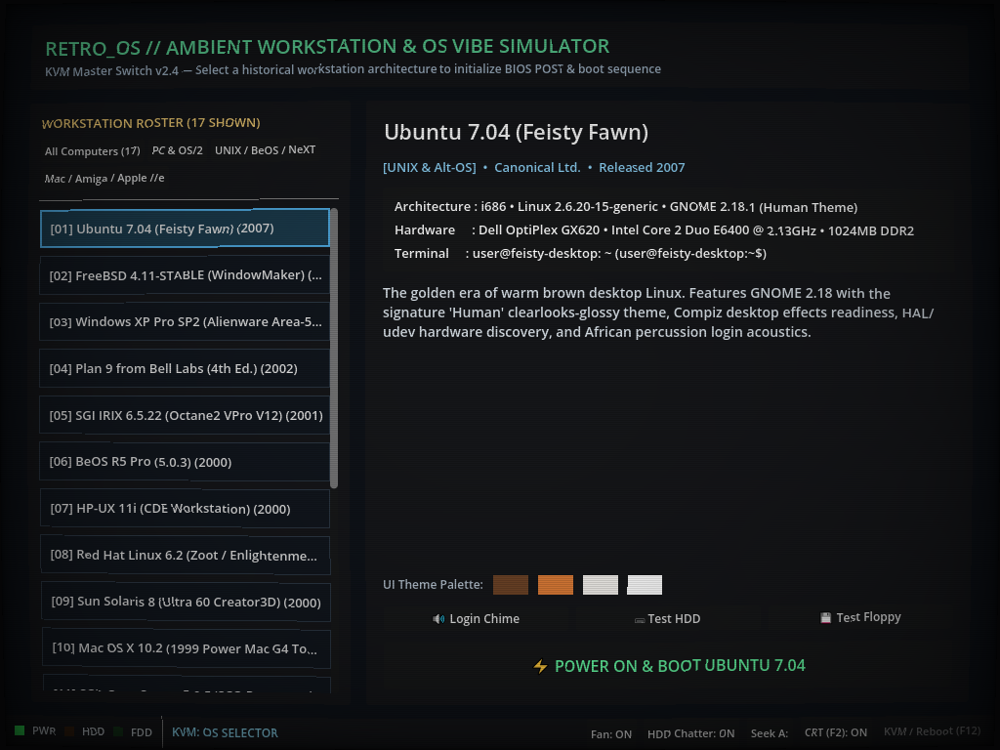

# RetroOS — Ambient Retro Workstation & OS Vibe Simulator


**RetroOS** is an ambient retro operating system and workstation vibe simulator built in **Godot 4**. Select from 19 historical operating systems and classic microcomputers arranged chronologically on a virtual KVM switch, watch period-accurate BIOS/firmware POST and kernel boot sequences, listen to continuous workstation cooling fans, IDE/SCSI hard disk chatter, 3.5" floppy drive stepper seeks, and 5.25" Apple Disk II track-bang recalibration, and interact with draggable/closable mock windows and OS-specific retro terminals.



---

## ✨ Included Operating Systems & Workstations (Chronological: 1972 → 2011)

| OS Profile & Machine | Era | Firmware & Bootloader | Desktop Environment & Chrome | Shell & Prompt |
| :--- | :---: | :--- | :--- | :--- |
| **Datapoint DOS 2.1 (Datapoint 2200)** | 1972 | CTC Bootstrap ROM 2.4 (8-bit Discrete TTL CPU) → Diablo Disk 0 → `DOS.SYS` | 12×80 Curved P31 Green CRT Console (`datapoint_green` chrome) | Datapoint DOS Executive (`: `) |
| **Apple IIe Enhanced (ProDOS 8 / BASIC)** | 1985 | Apple Computer Inc. Apple //e Enhanced 64KB ROM (65C02 @ 1.023MHz) → ProDOS 8 | 40/80-column monochrome green phosphor display with Shugart SA-390 stepper clacks | Applesoft BASIC (`]`) |
| **Commodore AmigaOS 3.1 (Amiga 3000)** | 1993 | Commodore Amiga 3000 Kickstart 3.1 (ROM 40.068, MC68030 @ 25MHz + Paula 8364) → `LoadWB` | Workbench 3.1 with 4-color Topaz palette (`#0055AA`, `#FFAA55`, `#FFFFFF`, `#000000`) and top screen menu bar | AmigaDOS CLI (`1.Workbench:>`) |
| **Mac OS System 7.5.3 (Quadra 840AV)** | 1995 | Apple Universal ROM $067C (Quadra 840AV MC68040 @ 40MHz + DSP3210) → System 7.5.3 | Classic Mac Finder with pinstriped titlebars, left close boxes, and Apple Menu | MPW / Standard File (`Quadra 840AV:`) |
| **NeXTSTEP 3.3 (NeXTstation Turbo Color)** | 1995 | NeXT ROM Monitor v3.3 (NeXTstation Turbo Color 68040 @ 33MHz + DSP56001) → Mach 3.0 / BSD 4.3 | NeXTSTEP Workspace Manager with dark gray titanium styling, floating application dock, and NeXT shelf | `csh` (`localhost>`) |
| **IBM OS/2 Warp 4 (Merlin)** | 1996 | IBM SurePath BIOS → Rev 9.023 → `HPFS.IFS` | Workplace Shell (`PMSHELL.EXE`) + Top-Docked IBM WarpCenter | `CMD.EXE` (`[C:\]`) |
| **Mac OS X 10.2 Jaguar (1999 G4 Tower)** | 1999 | Apple Open Firmware 3.1.1 (Power Mac G4 'Yikes!' PPC 7400 @ 400MHz) → Mach Kernel / Darwin 6.0 | Aqua GUI with brushed graphite/pinstripe styling, pulsating jelly buttons, and Dock | `tcsh` (`g4-tower:~ user%`) |
| **SCO OpenServer 5.0.5 (SCO Panorama)** | 1999 | AMI Desktop BIOS (Compaq ProLiant 1600 Dual Pentium III) → SCO boot → `/unix` (`HTFS`) | SCO PanoRama Desktop / Motif Window Manager with UnixWare/SCO bevels | Bourne shell `sh` (`#`) |
| **Windows 98 Second Edition** | 1999 | Award Modular BIOS v4.51PG → MS-DOS 7.10 → `WIN.COM` | Classic `#008080` Teal desktop, `#C0C0C0` 3D Win32 bevels, Start Menu & Taskbar | `COMMAND.COM` (`C:\WINDOWS>`) |
| **BeOS R5 Pro (5.0.3)** | 2000 | Award Modular BIOS v4.51PG (Tyan Tiger 100 Dual P-III) → BeOS Loader | BeOS Tracker & Deskbar with yellow tabbed titlebars and blue feather menu | `bash` (`/boot/home>`) |
| **HP-UX 11i (CDE Workstation)** | 2000 | HP Visualize C3600 PDC → ISL → `/stand/vmunix` | Motif / Common Desktop Environment 2.1 (Chiseled bevels & Front Panel) | POSIX `sh` (`hp9000:/home/root #`) |
| **Red Hat Linux 6.2 (Zoot)** | 2000 | PhoenixBIOS 4.0 → LILO 21.4 → Linux `2.2.14-5.0` (Dual Pentium II) | GNOME 1.2 Enlightenment E16 with classic Red Hat Footprint menu & RPM monitor | `bash` (`[root@zoot /root]#`) |
| **Sun Solaris 8 (Ultra 60 Creator3D)** | 2000 | Sun Ultra 60 OpenBoot 3.31 (Dual UltraSPARC II 450MHz) → UFS `/platform/sun4u/kernel/sparcv9/unix` | Sun CDE 1.4 / OpenWindows Workspace Manager with purple chisel styling | SunOS `csh` (`ultra60#`) |
| **SGI IRIX 6.5.22 (Octane2 VPro V12)** | 2001 | SGI IP30 ARCS PROM → Dual 600MHz MIPS R14000A → `/unix` (`XFS`) | Indigo Magic / `4Dwm` Desktop + Top-Left `Toolchest` + `gr_osview` | `tcsh` (`octane2 1%`) |
| **Plan 9 from Bell Labs (4e)** | 2002 | `9load` → `9pcf` Kernel → `fossil` | Rob Pike's `rio` (`#777777` workspace, `#FFFFEA` windows, `#55AAAA` borders, right-click menu) | Tom Duff's `rc` (`term%`) |
| **Windows XP Pro SP2 (Alienware Area-51)** | 2003 | AMIBIOS + Promise FastTrak RAID-0 (`2x WD Raptor 10K`) → `NTLDR` | Alienware *Predator* Full-Tower rig • Luna Blue & Green `start` bar + AlienAdrenaline | `cmd.exe` (`C:\Documents and Settings\Area51>`) |
| **FreeBSD 4.11-STABLE** | 2004 | Beastie Boot Menu (Dual-Pentium III SMP) → `/boot/kernel` | FreeBSD C-shell / XFree86 4.3 twm | `tcsh` (`daemonic#`) |
| **Ubuntu 7.04 (Feisty Fawn)** | 2007 | PhoenixBIOS 4.0 → GRUB 0.97 → Linux `2.6.20-15-generic` | GNOME 2.18 *Human* theme (Top & Bottom Panels, amber titlebars) | `bash` (`user@feisty-desktop:~$`) |
| **Ubuntu 10.04 LTS (AlexNet Workstation)** | 2010 | AMI EFI BIOS (ASUS P9X79 Dual GTX 580) → GRUB 1.98 → Linux `2.6.32-21` (CUDA 4.2) | GNOME 2.30 *Ambiance* aubergine theme (Left-aligned window controls) | `bash` (`alex@alexnet-node0:~$`) |
| **EVGA SR-2 Super Record (Triple-Boot)** | 2011 | EVGA Award BIOS v1.21 (Dual Xeon X5690 @ 4.4GHz + 4x FirePro V9800 + S400 Genlock) → BBS Selector | Triple-Boot: Windows 7 Aero Glass / Mac OS X Lion Aqua / Oracle Solaris 11 CDE | `cmd.exe` / `bash` / `ksh93` |

> **Extensible Architecture:** Adding new operating systems requires either registering a new `OSProfile` entry in `data/os_registry.gd` or dropping a `.tres` `OSProfile` resource file into `res://data/profiles/`. The KVM selector automatically sorts all profiles chronologically (earliest/oldest at the top, newest/latest at the bottom).

---

## 📁 Repository & Project Structure

```text
RetroOS/
├── .gitattributes
├── .gitignore
├── LICENSE
├── README.md
├── icon.svg
├── project.godot
├── assets/
│   ├── audio/
│   │   ├── README.md
│   │   ├── ambient/                  # Optional fan_hum.ogg override
│   │   ├── sfx/                      # Optional hdd_click.ogg, floppy_seek.ogg, post_beep.ogg
│   │   └── startup/                  # Optional <os_id>.ogg login sound overrides
│   ├── exhibits/                     # Historical or generated images (<os_id>/system|hardware|software.png)
│   │   └── README.md
│   ├── fonts/
│   └── shaders/
│       └── crt_monitor.gdshader      # CRT scanline, vignette & barrel curvature shader
├── autoload/
│   ├── game_state.gd                 # Global state singleton (GameState)
│   └── audio_manager.gd              # Procedural 16-bit PCM & sample audio engine (AudioManager)
├── data/
│   ├── os_profile.gd                 # Custom Resource class (OSProfile + Museum Exhibit fields)
│   ├── os_registry.gd                # Built-in OS definitions + res://data/profiles/ scanner
│   ├── exhibit_codex.gd              # Museum Exhibit coordinator & runtime image importer
│   ├── exhibit_codex_modern.gd       # Archival Exhibit Packages (2000–2007 systems)
│   ├── exhibit_codex_classic.gd      # Archival Exhibit Packages (1985–1999 systems)
│   └── profiles/                     # Drop-in directory for future .tres OSProfile resources
└── scenes/
    ├── main/
    │   ├── main_controller.tscn      # Root scene with Chassis Bezel LEDs & CRT CanvasLayer
    │   └── main_controller.gd
    ├── menu/
    │   ├── main_menu.tscn            # 1280x720 Wikipedia-style Digital Computing Codex & Hideable Sidebar
    │   ├── main_menu.gd
    │   └── exhibit_plate_renderer.gd # Renders custom archival images or procedural blueprint plates
    ├── boot/
    │   ├── boot_sequence.tscn        # BIOS POST & period-correct boot text crawl
    │   └── boot_sequence.gd
    └── desktop/
        ├── desktop_environment.tscn  # OS Desktop workspace, icons, panels & popup menus
        ├── desktop_environment.gd
        └── components/
            ├── retro_window.tscn     # Draggable, focusable, shadable, closable window
            ├── retro_window.gd
            ├── retro_terminal.tscn   # Interactive command prompt with command history
            └── retro_terminal.gd
```

---

## 🏛️ Wikipedia-Inspired Digital Computing Codex & Exhibit Packages

Each of the 19 systems in **RetroOS** includes a comprehensive **Museum Exhibit Package** (`data/exhibit_codex_*.gd`) presented in a **1280×720** encyclopedia interface modeled after Wikipedia:

1. **Hideable Catalog Sidebar (`[ ☰ Hide Sidebar [Tab] ]`)**:
   - Collapse or expand the left computer selection drawer at any time (via the top-left button or the `Tab` key) to read the Codex in full-width museum view, filter by category, or search across CPUs, vendors, and release years.
2. **Dual Reading Modes (`[ 📖 Wiki Light Mode / 🌙 Dark Archive Mode ]`)**:
   - Switch instantly between high-contrast **Dark Archival Mode** and classic **Wikipedia Parchment Light Mode** (`#f8f9fa` / `#ffffff` article sheets with `#eaecf0` rules).
3. **Encyclopedic Article Column**:
   - **Lead Summary & Numbered Table of Contents (`Contents`)**
   - **Section 1 — Historical Context & Origins**: Corporate history, market dynamics, and development milestones.
   - **Section 2 — Architecture & Engineering Innovations**: Deep-dive into CPU silicon, bus interconnects, graphics pipelines, and kernel/filesystem design.
   - **Section 3 — Period-Correct Usage Cases & Real-World Deployment**: Three structured case study dossiers per system detailing authentic operator roles, period software stacks, and real-world workflows.
   - **Section 4 — Cultural Legacy & Archival Significance**
   - **Section 5 — Curatorial Media & Image Archive**: Three image slots per machine (`system`, `hardware`, `software`) with live file attachment (`[ 📂 Attach Image... ]`) and automatic loading from `res://assets/exhibits/<os_id>/` (falling back to custom procedural vector blueprint plates when no external bitmap is present).
   - **Section 6 — Emulated Firmware, BIOS POST & Terminal Command Manifest**
4. **Right-Hand Wikipedia Infobox (`Infobox computing_system`)**:
   - Features the interactive 3-slot exhibit viewer (`🖥 System`, `🔬 Hardware`, `🪟 Software`), 18-row structured technical specification table, UI theme color swatches, hardware audio test bench, and the **`⚡ POWER ON & BOOT`** button.

---

## 🌳 Scene Layout Architecture

### 1. Root Scene (`scenes/main/main_controller.tscn`)
```text
MainController (Control) [main_controller.gd]
├── StageContainer (Control)          # Dynamically hosts MainMenu, BootSequence, or DesktopEnvironment
├── ChassisBezel (PanelContainer)     # Persistent bottom hardware monitor bezel
│   └── BezelMargin (MarginContainer)
│       └── BezelHBox (HBoxContainer)
│           ├── PwrLedRect (ColorRect)
│           ├── HDDLedRect (ColorRect)        # Pulses amber on HDD read/write clicks
│           ├── FDDLedRect (ColorRect)        # Pulses green on 3.5" floppy track seeks
│           ├── ActiveOSLabel (Label)
│           ├── FanToggleBtn (Button)
│           ├── HDDToggleBtn (Button)
│           ├── FloppySeekBtn (Button)
│           ├── CRTToggleBtn (Button)         # Hotkey: F2
│           └── KVMSwitchBtn (Button)         # Hotkey: F12
└── CRTLayer (CanvasLayer)
    └── CRTOverlayRect (ColorRect)            # crt_monitor.gdshader (mouse_filter = IGNORE)
```

### 2. Main Menu / Digital Museum Codex (`scenes/menu/main_menu.tscn`)
```text
MainMenu (Control) [main_menu.gd]
├── Background (ColorRect)
└── MarginContainer (MarginContainer)
    └── MainVBox (VBoxContainer)
        ├── HeaderPanel (PanelContainer)      # Sidebar Toggle [Tab], Search Bar, Wiki Light/Dark Toggle
        └── ContentHBox (HBoxContainer)
            ├── LeftSelectorPanel (PanelContainer)     # Hideable Computer Selection Sidebar
            │   └── ... -> OSListVBox (VBoxContainer)  # Chronological 2007 -> 1985 Catalog
            └── RightPreviewPanel (PanelContainer)     # Wikipedia-Style Codex Workspace
                └── ... -> PreviewVBox (VBoxContainer)
                    ├── ArticleBannerHBox (PreviewTitle, PreviewMeta)
                    ├── SectionNavHBox (Quick-Jump Section Filter Tabs)
                    └── CodexScroll -> CodexColumnsHBox (HBoxContainer)
                        ├── ArticleColumnVBox (DescriptionLabel, TOC, History, Usage Cases, Gallery)
                        └── InfoboxPanel (ExhibitPlateRenderer, BootButton, AudioBenchRow, 18-Row SpecsTable)
```

### 3. BIOS & Boot Sequence (`scenes/boot/boot_sequence.tscn`)
```text
BootSequence (Control) [boot_sequence.gd]
├── BackgroundRect (ColorRect)
└── MarginContainer (MarginContainer)
    └── VBoxContainer (VBoxContainer)
        ├── TopBar (HBoxContainer)
        │   ├── BiosHeaderLabel (Label)       # Award / Phoenix / IBM SurePath / HP PDC / 9load
        │   └── EnergyBadgeLabel (Label)      # ASCII EPA Energy Star / ROM badge
        ├── HeaderSep (HSeparator)
        ├── BootLogLabel (RichTextLabel)      # BBCode line-by-line startup crawl
        └── BottomRow (HBoxContainer)
            ├── BootProgressBar (ProgressBar)
            ├── SkipButton (Button)           # [SPACE / ENTER] Fast-Forward
            └── AbortButton (Button)          # [ESC] Return to Boot Selector
```

### 4. Desktop Environment & Components (`scenes/desktop/desktop_environment.tscn`)
```text
DesktopEnvironment (Control) [desktop_environment.gd]
├── WallpaperRect (ColorRect)
├── WallpaperAccent (ColorRect)
├── DesktopHintLabel (Label)
├── DesktopIconMargin -> IconContainer (VBoxContainer)
├── WindowsLayer (Control)                    # Hosts active RetroWindow instances
│   └── RetroWindow (PanelContainer) [retro_window.gd]
│       └── OuterVBox (VBoxContainer)
│           ├── TitleBar (PanelContainer)     # Drag handle + double-click window shade
│           │   └── TitleHBox (LeftMenuButton, TitleLabel, MinimizeButton, MaximizeButton, CloseButton)
│           └── BodyPanel (PanelContainer)
│               └── ContentMargin -> ContentHolder (Control)
│                   └── RetroTerminal (PanelContainer) [retro_terminal.gd]
│                       ├── BackgroundRect (ColorRect)
│                       └── MarginContainer -> VBoxContainer
│                           ├── OutputScroll -> OutputLabel (RichTextLabel)
│                           └── InputRow (PromptLabel, CommandInput)
├── TopPanel (PanelContainer)                 # Used by GNOME 2.18 & IBM OS/2 WarpCenter
├── BottomPanel (PanelContainer)              # Used by Win98 Taskbar, GNOME Window List, HP-UX CDE Front Panel
└── OSPopupMenu (PopupPanel)                  # Start Menu / GNOME Applications / Plan 9 rio right-click menu
```

---

## 🔊 Audio Architecture (`autoload/audio_manager.gd`)

`AudioManager` works **100% out-of-the-box with zero external audio dependencies** by synthesizing 16-bit PCM `AudioStreamWAV` waveforms at startup, while automatically loading custom `.ogg` files from `res://assets/audio/` whenever present:
1. **Workstation Fan Hum Loop (`start_fan_hum`, `trigger_fan_spinup`)**: Multi-harmonic axial fan drone (`60Hz` mains hum + `f1/f2/f3` rotor harmonics + low-pass filtered turbulent airflow noise) with zero-crossing loop smoothing and BIOS power-on RPM pitch surge.
2. **Hard Disk Head Clicks (`play_hdd_click`, `play_hdd_burst`)**: Voice-coil actuator transients (`1450Hz`/`2850Hz` damped impulses) triggered during boot logs, terminal command execution, window operations, and randomized background OS daemon intervals.
3. **3.5" Floppy Stepper Seek (`play_floppy_seek`)**: Solenoid head-load clunk followed by `18ms` stepper-motor track pulses (`195Hz` square/harmonic buzz).
4. **5.25" Apple Disk II Track-00 Bang (`play_disk2_bang`)**: Authentic Shugart SA-390 stepper clatter banging against the physical stop bracket.
5. **SCSI / ATAPI CD-ROM Optical Sled Seek (`play_optical_seek`)**: High-speed laser sled homing and lens focus calibration for 90s/2000s multimedia towers.
6. **Unique OS Startup Chimes (`play_os_startup_sound`)**:
   - `ubuntu_704`: Warm marimba/djembe resonant arpeggio (`B3 → F#4 → B4 → D#5`)
   - `freebsd_411`: Classic FreeBSD console dual-tone bell chime (`C5 + G5`)
   - `winxp_alienware`: Iconic 6-note Windows XP major chord swell (`Eb3 → Bb3 → Eb4 → F4 → G4 → Bb4`)
   - `plan9`: Minimalist Bell Labs pure harmonic fifths (`C4 → G4 → D5`)
   - `sgi_irix`: Resonant Silicon Graphics metallic workstation gong (`C3 + G3 + D4 + F#4 + A4`)
   - `beos_r5`: Distinctive BeOS warm 4-note ascending marimba/synth sequence (`C4 → E4 → G4 → C5`)
   - `hpux_cde`: Metallic FM UNIX workstation crystal chord (`E4 + B4 + F#5 + G#5`)
   - `redhat_62`: Red Hat Linux dual console chime (`A4 + E5`)
   - `solaris_8`: Sun UltraSPARC OpenBoot keyboard bell (`F#5`)
   - `win98_se`: Shimmering ambient pad & bell cascade (`Eb4 → Bb4 → Ab4 → Eb5 → Bb5`)
   - `macosx_g4`: Historic Apple Power Mac G4 major triad chime with rich ambient sustain (`F-major`)
   - `sco_openserver`: ProLiant dual server console chime (`D4 + A4`)
   - `os2_warp`: Deep IBM orchestral synth swell (`D3 + A3 + D4 + F#4 + A4`)
   - `mac_sys75`: Iconic Quadra 840AV C-major harmonic power chime
   - `nextstep_33`: Steve Jobs' NeXT Computer warm stereo digital bell triad (`Eb4 + Bb4 + G5`)
   - `amiga_os31`: Paula 8-bit DMA stereo harmonic arpeggio (`A3 → C#4 → E4 → A4`)
   - `apple_iie`: High-pitched 1000Hz Apple II built-in speaker beep

---

## ⌨️ Interactive Terminal Commands

Click inside any terminal window and type commands (`Up` / `Down` arrows navigate command history):
- **Universal Commands**: `help`, `clear` / `cls`, `neofetch`, `date`, `whoami`, `floppy`, `cdrom` / `eject`, `reboot`, `exit`
- **Ubuntu 7.04**: `uname -a`, `lsb_release -a`, `cat /etc/issue`, `ls`, `ls -la`, `free -m`, `df -h`, `apt-get moo`, `ps aux`
- **FreeBSD 4.11**: `uname -a`, `dmesg`, `top`, `df -h`, `sockstat`, `fortune`
- **Windows XP (Alienware)**: `ver`, `dir`, `tasklist`, `systeminfo`, `dxdiag`, `alienware`, `winamp`
- **Plan 9**: `lc`, `cat /dev/drivers`, `cat /dev/osversion`, `cat /dev/sysname`, `ps`, `ns`, `fortune`, `glenda`
- **SGI IRIX 6.5**: `uname -aR`, `hinv`, `gr_osview`, `glman`, `top`, `ls -la`
- **BeOS R5**: `uname -a`, `sysinfo`, `listres`, `ps`, `cat /boot/home/welcome.txt`
- **HP-UX 11i (CDE)**: `uname -a`, `model`, `bdf`, `ioscan -fn`, `swapinfo`, `sam`, `ls`
- **Red Hat 6.2**: `uname -a`, `rpm -qa`, `cat /etc/redhat-release`, `free -m`, `ls`
- **Sun Solaris 8**: `uname -a`, `psrinfo -v`, `showrev -p`, `prtconf`, `df -k`, `ls`
- **Windows 98 SE**: `ver`, `dir`, `mem`, `ipconfig`, `winver`, `type autoexec.bat`, `type config.sys`
- **Mac OS X 10.2 (G4)**: `sw_vers`, `uname -a`, `system_profiler`, `top`, `cal`, `uptime`
- **SCO OpenServer**: `uname -a`, `hwconfig`, `df -v`, `sysconf`, `ls`
- **OS/2 Warp 4**: `ver`, `dir`, `chkdsk`, `type config.sys`, `pstat`
- **Mac System 7.5.3**: `about`, `dir`, `memory`, `system`, `extensions`, `pr#6`
- **NeXTSTEP 3.3**: `uname -a`, `hostinfo`, `ps aux`, `mach_sw`, `ls`
- **AmigaOS 3.1**: `version`, `dir`, `avail`, `info`, `list`, `type s:startup-sequence`
- **Apple IIe Enhanced**: `catalog`, `catalog d1`, `list`, `run`, `print 2+2`, `pr#6`, `call -151`

---

## 🚀 Getting Started

1. Clone this repository:
   ```bash
   git clone https://github.com/your-username/RetroOS.git
   ```
2. Open **Godot Engine 4.2+** and import `project.godot`.
3. Press **F5** (Run Project).
   - Use **F2** to toggle the CRT scanline shader.
   - Use **F12** to return to the KVM OS Selector at any time.

